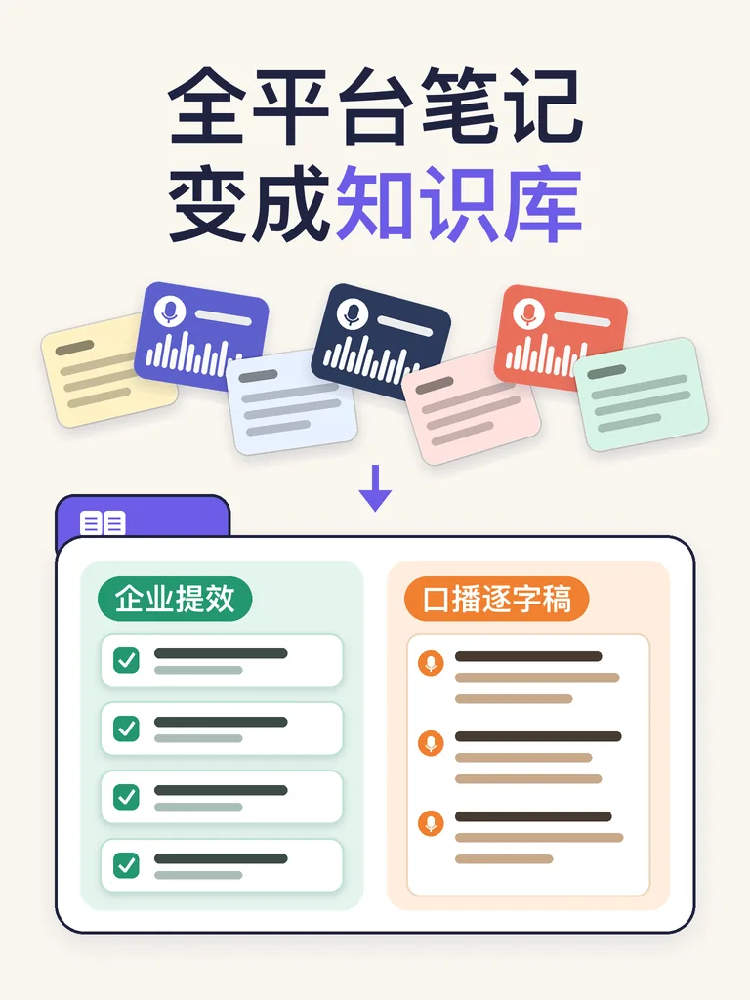

<div align="center">



# 全平台笔记 → 本地 Obsidian 知识库

**一句话，让 AI 把你散落在得到、ima、飞书、录音卡里的笔记和录音，整理成一个能直接拿来干活的第二大脑。**

数据全部存在你自己电脑上 · 小白零代码 · 一个 Agent Skill 搞定

✅ **得到大脑 · 飞书 · 腾讯 ima 三大来源已用真实账号实测跑通，一条命令全自动导入**

</div>

---

## 你是不是也这样？

- 📱 开会用飞书妙记，听课用得到，灵感记在 ima，见客户掏出录音卡……**内容很多，但散在 5 个 App 里，用的时候一条也找不到**
- 🎙️ 录了几百小时的客户沟通，**真正能复用的方法、话术、案例，全埋在逐字稿里**
- ✍️ 做自媒体天天愁选题，**其实最好的选题就在你和客户的对话里**
- 🔒 想用 AI 整理，又**不放心把客户资料全交给某个云平台**

这个 Skill 就是为这些事做的。

## 装好之后你会得到

| | |
|---|---|
| 📚 **一个本地知识库** | 所有笔记按「客户沟通、合作洽谈、内部会议、方法与SOP、选题素材……」自动分好类，每条录音都带完整逐字稿，全文可搜 |
| 💼 **企业提效看板** | 待办清单、可沉淀成 SOP 的经验、客户和合作伙伴一览，按业务线、行业、人物随时筛 |
| 🎬 **自媒体选题库** | AI 给每条笔记打「口播潜力」分，高潜力的直接给出视频标题，一键写成 60 秒口播逐字稿 |
| 🔁 **一句话更新** | 以后说「更新知识库」，只把新内容加进来，你在 Obsidian 里改过的笔记不会被覆盖 |

## 支持哪些来源

| 来源 | 怎么拿数据 | 状态 |
|---|---|---|
| 得到大脑（含得到录音卡） | 官方 CLI，浏览器点一下授权，全自动 | ✅ 实测 400+ 条 |
| 飞书知识库 / 云空间文档 / 上传的 PDF·Word / 妙记纪要 | 官方 lark-cli，浏览器授权后一条命令全自动 | ✅ 实测 57 条 |
| 腾讯 ima 笔记 / 知识库里的 PDF·Word·Markdown | 官方 OpenAPI，网页生成密钥、弹窗粘贴，一条命令全自动 | ✅ 实测 7 个知识库 |
| Plaud 等录音卡 | 官方 CLI/MCP，或 App 导出 TXT/SRT/MD | ✅ 文件导入已测 / ⚠️ CLI 未实测 |
| 钉钉闪记、通义听悟、讯飞听见 | 导出 docx / txt / srt | ✅ 文件导入已测 |
| Notion、印象笔记、有道、Apple 备忘录 | 导出 Markdown / Word / PDF | ✅ 文件导入已测 |
| 电脑里的一堆 Word / PDF / TXT | 放进一个文件夹 | ✅ |

文件导入支持 `.md .txt .docx .pdf .srt .vtt .html`，zip 自动解压，GBK 编码的 txt 也能读；录音的「摘要」和「原文」两个文件会自动合成一条笔记。

## 适合谁

- **自媒体创作者 / 知识 IP**：把听课笔记、客户咨询、灵感闪念变成选题库，按固定框架批量写口播稿
- **企业老板 / 销售 / 咨询顾问**：把客户沟通、会议录音沉淀成客户档案、待办和 SOP，新人也能查
- **两者都要的**：默认就是「双轨模式」，一个库两个看板

## 安装

需要一个支持 Agent Skills 的 AI 助手，例如 [Claude Code](https://claude.com/claude-code)。

**方法一：让 AI 帮你装（最简单）**

把这句话发给你的 AI 助手：

> 帮我从 https://github.com/Ericxiang2025/notes-to-obsidian 安装 notes-to-obsidian 这个 Skill

**方法二：命令行**

```bash
git clone https://github.com/Ericxiang2025/notes-to-obsidian.git
mkdir -p ~/.claude/skills
cp -r notes-to-obsidian/notes-to-obsidian ~/.claude/skills/
```

其他支持 Skill 的工具，把 `notes-to-obsidian/` 文件夹放进它的 skills 目录即可。

**环境**：Python 3.9+（脚本只用标准库）；用得到大脑、飞书需要 Node.js 20+；Obsidian 会在过程中帮你装好。macOS 实测；Windows 写了适配但未实测，遇到问题欢迎提 Issue。

## 怎么用

装好后，直接跟 AI 说：

- 「帮我把笔记做成知识库」——AI 会一项一项问你：想用来做什么、怎么称呼你、笔记都在哪些 App，然后带你授权或导出，30-60 分钟建好
- 「更新知识库」——把新录的、新记的加进来
- 「用知识库帮我写一条口播」「这周拍什么」——从选题库挑素材，按框架写逐字稿
- 「整理一下最近的客户问题」「把上周的会议待办列出来」「把这几次培训整理成 SOP」

## 隐私与安全

- **只读**：不会在任何平台新建、修改或删除你的笔记
- **本地**：所有数据和知识库都在你自己电脑上，不上传到任何第三方服务器（AI 分类时笔记摘要会发给你正在用的 AI 模型）
- **不碰密钥**：需要 API Key 的平台，会请你自己把 Key 存进本机文件，不在对话里粘贴
- 建库时会自动扫一遍笔记里的密码、身份证号、银行卡号，提醒你处理

## 目录结构

```
notes-to-obsidian/
├── SKILL.md                    # AI 读的主流程
├── references/
│   ├── sources-guide.md        # 各平台导出方法
│   ├── taxonomy-template.md    # 分类规范
│   ├── koubo-framework.md      # 口播逐字稿写作框架
│   └── after-install-guide.md  # 装好后的上手引导
└── scripts/
    ├── fetch_getnote.py        # 得到大脑
    ├── fetch_feishu.py         # 飞书知识库 / 云空间
    ├── fetch_ima.py            # 腾讯 ima 笔记 / 知识库
    ├── setup_ima.py            # ima 密钥弹窗保存（不经过聊天）
    ├── import_files.py         # 其他所有导出文件
    └── ...                     # 分类合并、建库、生成 Obsidian 仓库
```

## 作者

**文丰** —— 口播逐字稿框架来自文丰老师自己的内容创作方法。

欢迎提 Issue 补充新的来源或反馈问题；觉得有用请点个 ⭐。

## 许可

[MIT](LICENSE)
